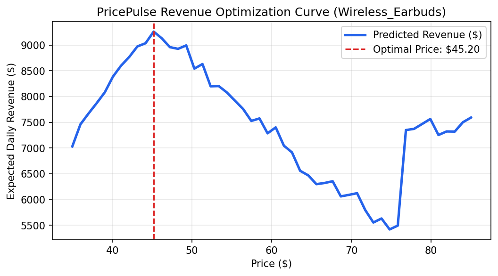

# 📈 PricePulse: Adaptive Dynamic Pricing & Revenue Optimization Engine

An end-to-end machine learning dynamic pricing simulator built with **XGBoost** and **Streamlit** that models price elasticity, competitor gaps, inventory constraints, and promotional lift to compute revenue-maximizing prices in real time.

## 🚀 Key Results & Benchmarks
- **Test MAE:** `4.80 units` (Target: < 8.0)
- **Test R² Score:** `0.9803`
- **Multi-SKU Coverage:** 4 E-Commerce Categories (`Wireless_Earbuds`, `Smart_Watch`, `Mechanical_Keyboard`, `USB_C_Hub`)

## 📊 Revenue Optimization Curve


## 🧠 Architecture & Features
1. **Elasticity & Demand Modeling:** XGBoost Regressor trained on historical pricing, competitor price differentials (`Price_Diff_Comp`), stock levels, weekend traffic, and flash-sale flags.
2. **Inventory-Aware Revenue Maximization:** Evaluates 60 candidate price points per query while capping effective sales at available inventory (`min(Predicted_Demand, Inventory)`) to prevent stockouts.
3. **Interactive Pricing Simulator:** Live sliders and toggles comparing optimal dynamic pricing against static competitor-matching baselines.

## ⚙️ Run Locally
```bash
pip install -r requirements.txt
streamlit run app.py